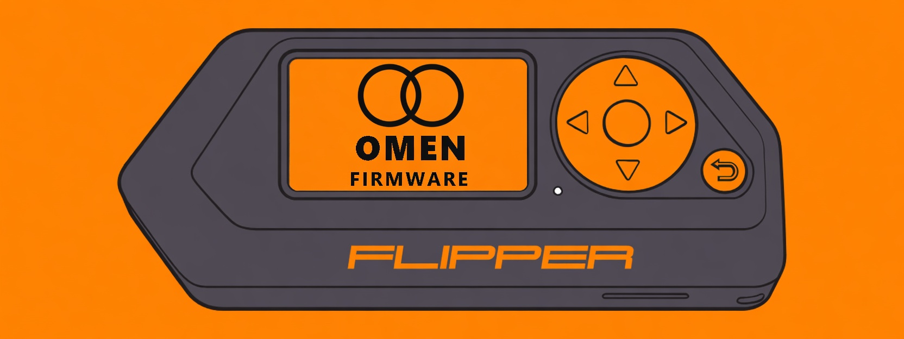

# Omen

Flipper Zero firmware. Base is Unleashed `1672f7c54`, API 88.22.

 

## Install

One file: `omen-update.tgz` on the latest release.

qFlipper or the Flipper mobile app, channel Custom. Or unpack it and open `update/f7-update-omen/update.fuf` on the device.

## Where files go

After the first boot these folders are on the card:

| Folder | What goes in |
| --- | --- |
| `subghz` | Sub-GHz remotes, `.sub` |
| `nfc` | NFC cards |
| `lfrfid` | 125 kHz RFID |
| `infrared` | Infrared remotes |
| `ibutton` | iButton keys |
| `badusb` | Bad USB scripts |
| `apps` | Applications: Sub-GHz, NFC, RFID, Infrared, GPIO, USB, Bluetooth, Games, Tools, Media |

Timer is in the main menu. One background timer at a time.

## Build

Put this folder next to `omen-src` and run `build-omen.bat`. The package replaces `omen-update.tgz` next to the script. Old version folders are removed. `build-omen.bat base` skips the extra pack.

## License

GPL-3.0-only.